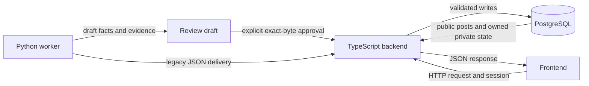

# Aptus frontend, backend and worker contracts

Revision: local-v1.1, 27 October 2026. Coordinator-owned. Read the
[coordination protocol](../AGENT_CONTRACT_PROTOCOL.md) before changing this set.

## Scope and authority

These contracts describe the local integration candidate at
`4fa532ef74df0ac015199204cf270beb3c564d3f`, reconciled with recorded released
revision `7e974cc098f405475f7093567bcf26cde4c40a4a`. They do not prove a remote
branch, deployed image or production runtime. The source hashes in
`contracts/baseline.json` remain historical provenance for the original
local-v1 inspection. This revision corrects observed transport and matcher
wording; it changes no runtime endpoint or data policy.

The invariant rules below preserve existing project decisions. Historical
findings remain evidence, not accepted behavior merely because they existed in
the original local-v1 snapshot. This revised record reflects the tested
integration candidate; do not treat it as proof of a remote or production release.

| Relationship                | Concrete contract                                                    | Executable artifacts                                                                                                                  |
| --------------------------- | -------------------------------------------------------------------- | ------------------------------------------------------------------------------------------------------------------------------------- |
| Frontend ↔ backend          | [Requests, responses, auth, dates and unknowns](frontend-backend.md) | `contracts/http.openapi.json`, `contracts/http.schema.json`, `scripts/contracts/frontend-backend.test.ts`                             |
| Worker ↔ backend            | [Legacy ingestion and reviewed publication](worker-backend.md)       | Existing `services/ai/candidate-storage.schema.json`, `contracts/legacy-post.schema.json`, `scripts/contracts/worker-backend.test.ts` |
| Worker → backend → frontend | [Field lineage and review visibility](worker-frontend.md)            | Frozen fixtures and `tests/triangle-contract.test.ts`                                                                                 |
| Findings and research       | [Evidence, gaps and sources](analysis-and-sources.md)                | `scripts/contracts/audit-consumers.ts`                                                                                                |



There is no direct frontend/worker API, browser-triggered extraction or public
draft endpoint. The third relationship is a semantic lineage contract through
the backend, not a new service connection. In HTTP terminology, the frontend
and worker are clients/consumers and the backend is the provider. The worker is
also the _data producer_ for incoming facts. Keep these two meanings distinct.

## Rules that every lane must preserve

1. Required key and nullable value are separate. Missing, null, empty, zero and
   false have different meanings. Do not convert unknown facts into eligibility.
2. Python extraction owns source facts; deterministic application code owns
   eligibility. Browser requests never trigger fresh extraction.
3. Browser state and submitted IDs do not authorize private access. Backend
   session identity selects the account for profile and saved jobs.
4. Draft existence, valid schema, located quotes and review approval are separate
   states. Only explicit approved publication creates public reviewed posts.
5. Retry delivery of the same immutable draft without repeating paid extraction.
   A receipt must prove the expected draft and post set, not merely HTTP success.
6. Implementers must not edit contract definitions, frozen fixtures, protected
   checks, schema generation rules or expected results to fit their own changes.
   Use the protocol's change request and coordinator/Hemant decision process.

## Running the checks

From this repository root, with existing dependencies and Python venv:

```bash
DOTENV_CONFIG_PATH=/dev/null pnpm test:contracts
DOTENV_CONFIG_PATH=/dev/null pnpm audit:contracts
DOTENV_CONFIG_PATH=/dev/null pnpm check:contracts
PYTHONPATH=services/ai services/ai/.venv/bin/python -m unittest discover -s services/ai/tests -q
pnpm typecheck
pnpm lint
```

`test:contracts` checks selected real boundary paths and frozen artifacts.
`audit:contracts` checks the protected consumers and matcher behavior. **Both
matter.** A passing boundary suite is not blanket acceptance. `check:contracts`
combines both as the handoff gate. On the integration candidate it passes with
zero audit findings; this still does not prove deployment or production behavior.
Commands require no provider calls, production reads/writes or live credentials.
The suite substitutes database operations and session lookup only; it does not
connect to PostgreSQL. It does not load `.env` intentionally.

Existing `scripts/reviewed-ingest.test.ts` and
`scripts/publish-extraction-candidate.test.ts` have separate database scenarios.
Those need an explicitly disposable local `TEST_DATABASE_URL` and are not
substituted by the offline suite. The Node package and CI commands now name root
and nested contract tests explicitly: `scripts/*.test.ts scripts/contracts/*.test.ts`.
This prevents shell expansion from selecting only nested tests after the new
directory exists. The candidate CI workflow runs `pnpm check:contracts` before
the Node test command. Remote CI and required-check enforcement remain separate
release evidence; GitHub branch-protection access is unavailable for this private
repository's current plan.

## Protection and change control

Coordinator-controlled artifacts are this directory, `contracts/**`,
`scripts/contracts/**`, the existing candidate storage schema/generator and
related acceptance tests. `contracts/lock.json` records SHA-256 hashes of the
contract artifacts; the suite fails if protected bytes drift. The lock is not
a security boundary: an agent able to edit both the file and lock can bypass it.
The coordinator must review both against the agreed batch baseline. Do not
regenerate the lock automatically on every test run.

Update a contract only through an explicit proposal with before/after examples,
affected consumers, migration/deployment order and rollback, followed by the
recorded approval. Then update the revision, artifacts, lock and tests in a
separate reviewable contract change; notify all affected lanes. Documentation
revision is independent of API versioning; this work adds no `/v2` route.

## Coverage limit

Code tracing covers custom public/profile/saved/match/explain/ingestion APIs,
the current Next and legacy clients, reviewed draft/storage/publication,
relevant Prisma models, filtering, deadlines and recovery delivery. Better Auth
OAuth/passkey internals are delegated to the pinned library and existing auth
tests; this is not a new complete authentication specification or security audit.
No whole-product browser, real DB, production, performance or release claim
follows from these artifacts. Consult the findings document for actual results.
